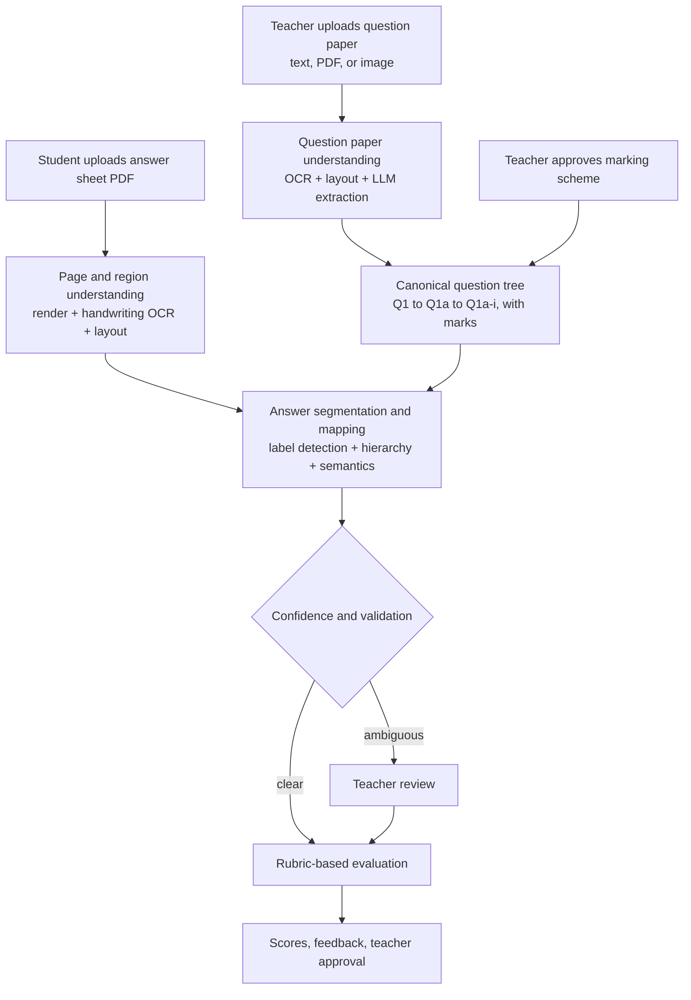

# Architecture

## Guiding principle

The system separates **answer identification** from **answer evaluation**.
It first understands the question paper, then reads the student's sheet,
then maps each answer to the right question and subpart, and only then
scores it against a marking scheme.

Each of these is a separate, auditable decision. The system preserves the
original text and page position of every answer throughout the pipeline,
so a teacher can verify exactly what the model interpreted at each step.

## Pipeline



## Stage 1 — Understand the question paper

The paper is converted into a canonical question tree rather than a flat
list of lines. A question has an id, a display number, text, marks, an
optional parent, and child subparts to any depth.

```
Q1  "Answer the following:"
├── Q1_a  "(a) Name the founder of Apple."   2 marks
└── Q1_b  "(b) What is a CPU?"               3 marks
Q2  "Explain the working of a computer."     5 marks
Q3  "List three input devices."              3 marks
```

Production parsing uses OCR for printed text, a vision model for diagrams
and image-based papers, and layout analysis to tell apart question
numbers, question text, subparts, instructions and marks. An LLM with
structured output normalises the result into the tree. Marks and
hierarchy are validated for consistency, and the teacher can correct
extraction errors.

The marking scheme is kept **separate** and teacher-approved. The system
may propose expected answers, but it never treats a guess as
authoritative.

## Stage 2 — Process the student's sheet

A scanned sheet is usually images, not text. Processing renders each page
at sufficient resolution, reads the handwriting with an OCR engine or a
vision-language model, and detects answer regions using visual layout and
reading order. Every region keeps its recognised text, source page and
bounding boxes.

Lexing is deliberately dumb: it reports the *shape* of each line — a
question-style label, a subpart marker, a bare number, a bullet, or plain
content — without deciding what that shape means. That decision needs the
question tree, so it belongs to the next stage.

## Stage 3 — Segment and map answers

This is the core challenge. Three ideas must not be confused:

| Concept        | Example                | Meaning                     |
| -------------- | ---------------------- | --------------------------- |
| Question label | `Q1`, `1(b)`           | Which question is answered  |
| Subpart label  | `(a)`, `(i)`           | Which subpart is answered   |
| Answer content | `Sam`, `Apple`, `CPU`  | The response itself         |

The same handwritten number can be any of these depending on context, so
the engine combines several signals:

1. **Explicit numbering** — did the student write `Q1`, `1(a)`, `(ii)`?
2. **Question hierarchy** — does that label exist in the paper?
3. **Spatial layout** — is the number at the margin as a heading, or indented under an answer?
4. **Structure** — is it followed by a colon, a paragraph, a list, or another heading?
5. **Semantic relevance** — does the content plausibly answer the question?
6. **Continuity** — does the next region continue, start a subpart, or begin a new question?

Semantic relevance helps resolve ambiguity but never overrides a valid
explicit label just because the answer looks wrong. A student can write a
wrong answer to the right question.

### The four cases the engine must handle

| Case | Student wrote | Interpretation |
| ---- | ------------- | -------------- |
| A — point-wise | `Q1.` then `1. Sam  2. Apple  3. CPU` | One answer to Q1 with three ordered points. The numbers are list markers. |
| B — subparts | `Q1.` then `(a) ...  (b) ...` | Separate answers mapped to Q1(a), Q1(b), if those subparts exist. |
| C — out of order | `Q3 ...  Q1(b) ...  Q1(a) ...` | Mapped by explicit label, not page order. |
| D — ambiguous | `1. Sam  2. Apple  3. CPU` with no header | Could be list points or separate answers. Both interpretations are retained and the answer is flagged. |

### Mapping rules

- An explicit label that matches a question or subpart is the primary signal.
- A missing or unclear label falls back to layout, neighbours, semantics and the hierarchy.
- A label for a question that does not exist is **flagged**, never forced into a valid question.
- Two answers mapping to the same subpart are kept and flagged as a possible duplicate or continuation.
- An answer that spans pages is joined only when layout, numbering and content agree.
- Anything that cannot be mapped reliably goes to a teacher.

Mapping supports many-to-one: several paragraphs, points or diagrams can
belong to one question.

## Stage 4 — Evaluate

Only after mapping does the grading engine compare the answer against the
rubric for that exact question. Mapping and scoring stay separate and
auditable: a grading model must never silently move an answer to a
question it fits better.

The evaluator considers equivalent wording, partial credit, reasoning and
diagrams. Maths and science may need separate verifiers for equations,
calculations and units. High-confidence answers can be scored
automatically; ambiguous mappings and grading disagreements go to a teacher.

## Data model

| Type           | Holds |
| -------------- | ----- |
| `Question`     | id, display number, text, marks, parent, children, rubric |
| `AnswerRegion` | recognised text, source page, detected label, structured points |
| `Mapping`      | mapped question, candidates, method, confidence, review flag, note |
| `Score`        | awarded, max, per-criterion breakdown, feedback, provisional flag |

The `Mapping` is stored apart from both the `AnswerRegion` and the
`Score`. That is the whole point: what was written, where it was mapped,
and what it earned are three records, not one.

## Prototype modules

The prototype in [exam_eval/](exam_eval/) mirrors the stages one to one.

| Module | Responsibility |
| ------ | -------------- |
| [models.py](exam_eval/models.py) | Shared data types |
| [labels.py](exam_eval/labels.py) | Surface recognition of labels and marks |
| [question_parser.py](exam_eval/question_parser.py) | Paper text to canonical question tree |
| [marking_scheme.py](exam_eval/marking_scheme.py) | Attach a teacher-approved rubric to the tree |
| [answer_extractor.py](exam_eval/answer_extractor.py) | Lex the sheet into shape-tagged blocks |
| [mapping_engine.py](exam_eval/mapping_engine.py) | Segment and map answers; resolve Cases A–D |
| [evaluator.py](exam_eval/evaluator.py) | Rubric scoring, after mapping only |
| [pipeline.py](exam_eval/pipeline.py) | Orchestrate and keep stage outputs distinct |

The prototype works on text, so OCR, vision and the LLM rubric judge are
left as boundaries. The confidence numbers are illustrative heuristics,
not calibrated model scores.

## Technology stack (production)

| Component | Suggested implementation |
| --------- | ------------------------ |
| Frontend | React or SAPUI5 for upload, review and grading |
| Backend | Python + FastAPI, asynchronous processing |
| PDF processing | PyMuPDF or PDFium |
| OCR / handwriting | Handwriting OCR engine or multimodal vision model |
| Layout detection | Document-layout model plus image processing |
| Question extraction | LLM with JSON Schema structured output |
| Answer mapping | Rules engine + hierarchy validation + embeddings + vision/LLM fallback |
| Vector retrieval | pgvector or FAISS, only if useful at scale |
| Database | PostgreSQL for exams, questions, regions, mappings, scores |
| File storage | Object storage for PDFs, page images, artifacts |
| Background processing | Celery + Redis, or a managed queue |
| Audit | Structured logs, status, confidence tracking, review history |

A knowledge graph or multi-agent system is intentionally avoided at the
start. Reliable document parsing and question-to-answer mapping come
first; more sophisticated components are added only if evaluation data
shows they are needed.

## Teacher review

The teacher sees the original answer, its page image and bounding boxes,
and the system's interpretation side by side. They can correct the
mapping, approve or adjust marks, and choose between detected structures
(for example: three points in one answer, three separate answers, or
three subparts). Each correction is stored as an auditable event and can
later help improve the extraction and mapping models.

## Reliability and evaluation

Quality is measured per stage, not as one accuracy number.

| Stage | Metrics |
| ----- | ------- |
| Question-paper extraction | Question/subpart precision and recall |
| Handwriting recognition | Character or word error rate |
| Answer segmentation | Answer-region precision and recall |
| Question mapping | Exact question/subpart mapping accuracy |
| Grading | Agreement with human scores; partial-credit accuracy |
| End-to-end | Share of answers mapped and scored without correction |

A review threshold set on a labelled validation set decides what is
auto-evaluated and what goes to a teacher. Hard cases are tested
explicitly: missing numbers, crossed-out answers, overwritten labels,
multiple answers per question, out-of-order answers, nested subparts,
diagrams, multilingual handwriting and page continuations.

## Implementation sequence

1. Build the question-paper parser and the canonical question tree.
2. Build PDF ingestion and answer-region extraction, keeping page images and coordinates.
3. Implement hierarchical mapping with explicit-label rules and ambiguity handling.
4. Create the teacher review UI and collect a labelled evaluation dataset.
5. Add rubric-based grading with partial credit, evidence and teacher approval.
6. Run an end-to-end evaluation on permissioned, anonymised sheets before enabling automatic grading.
