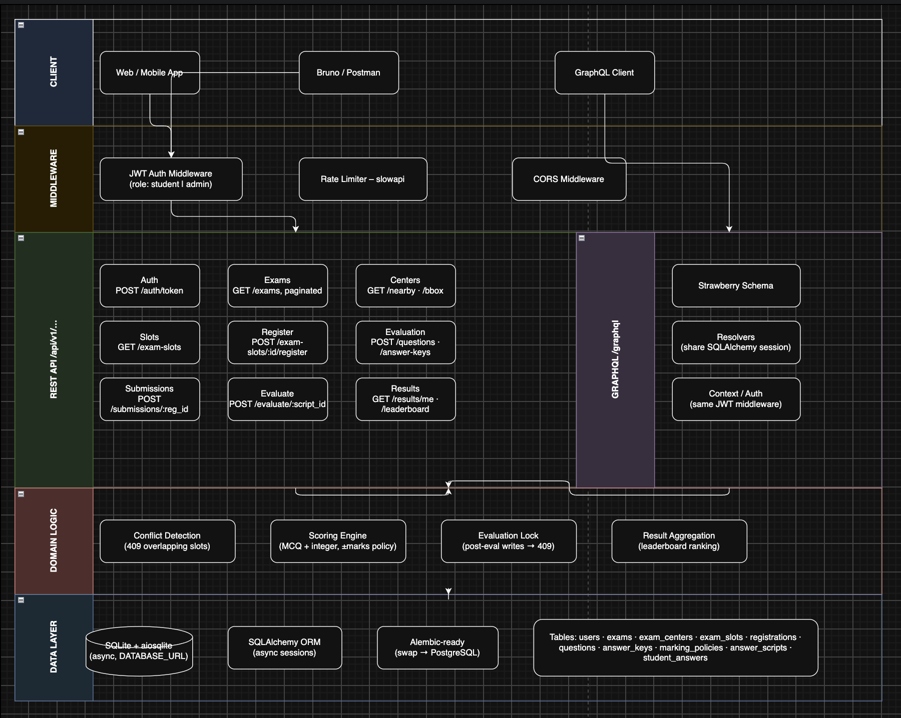

# Architecture Decision Record

## Approach A: REST-first, GraphQL layer on top

### Domain

Exam scheduling, answer submission, automated evaluation, and result reporting.

---

## Architecture Diagram

## Key Design Decisions

### 1. REST-first, GraphQL as a read layer
REST endpoints own all mutations and enforce business rules (conflict detection, evaluation locking). GraphQL is mounted on top purely for flexible querying — it shares the same SQLAlchemy session and auth middleware.

### 2. SQLite + aiosqlite for persistence
Chosen for zero-dependency deployment (single binary, no external DB). The async driver keeps uvicorn's event loop unblocked. Swap to PostgreSQL by changing `DATABASE_URL` and the SQLAlchemy dialect.

### 3. JWT bearer auth
Stateless tokens; role (`student` / `admin`) is embedded in the payload. No session store needed.

### 4. Post-evaluation lock on submissions
Once an answer script is evaluated, the submission endpoint returns 409. This prevents score tampering via re-submission.

### 5. Conflict-aware slot registration
Registration checks for overlapping time windows across all of the student's registered slots and returns 409 before writing, keeping the DB consistent without transactions spanning multiple requests.
